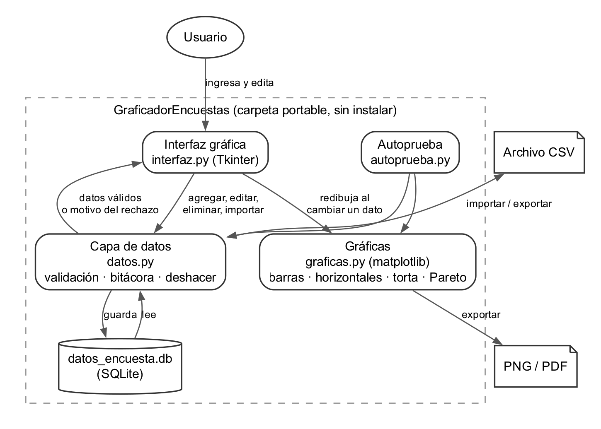
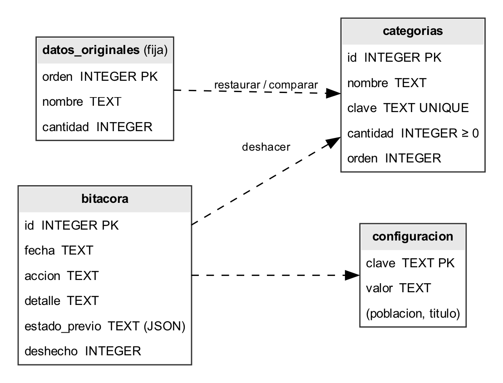
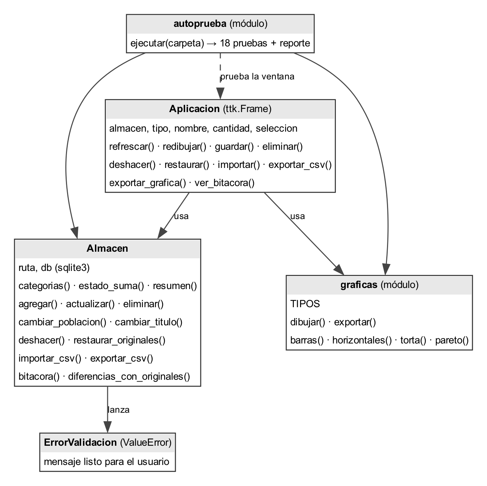
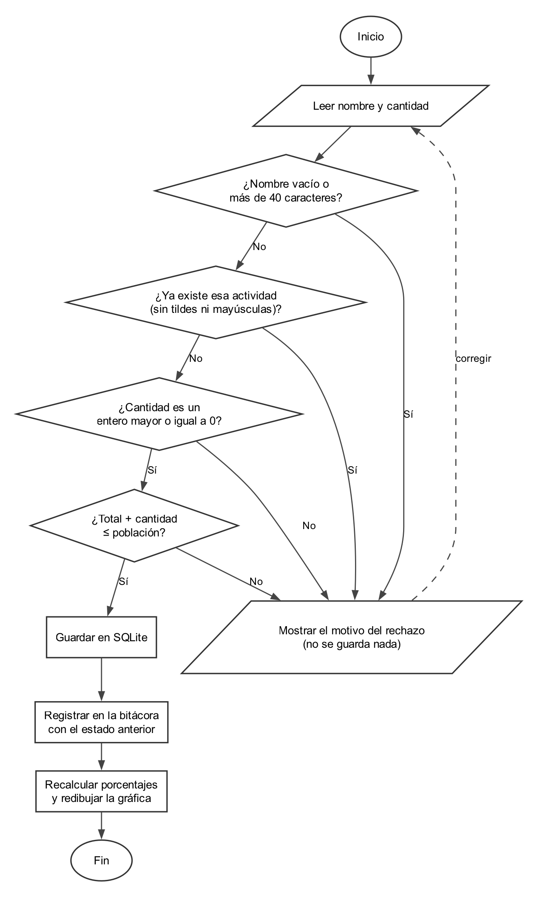
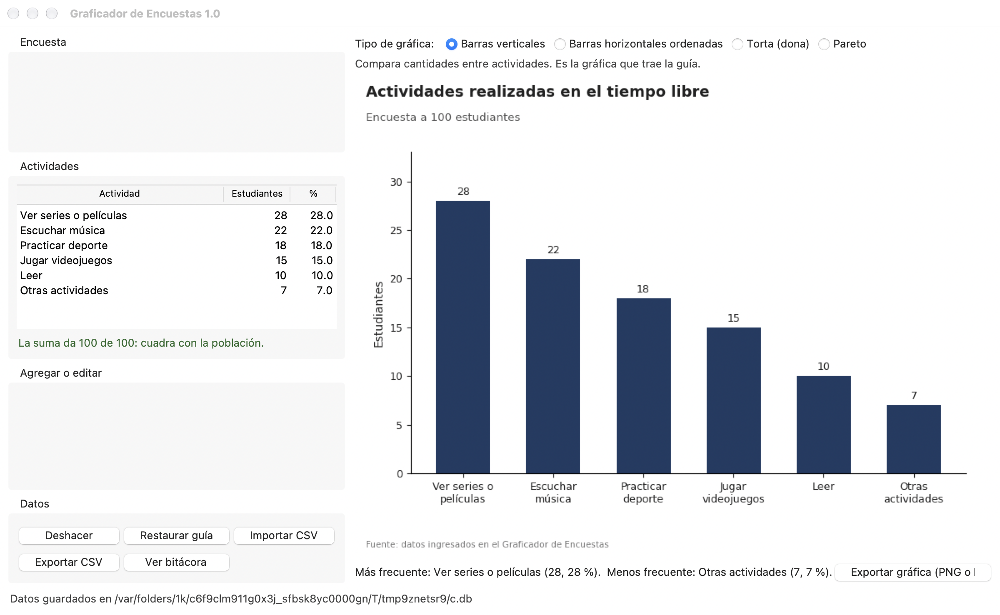
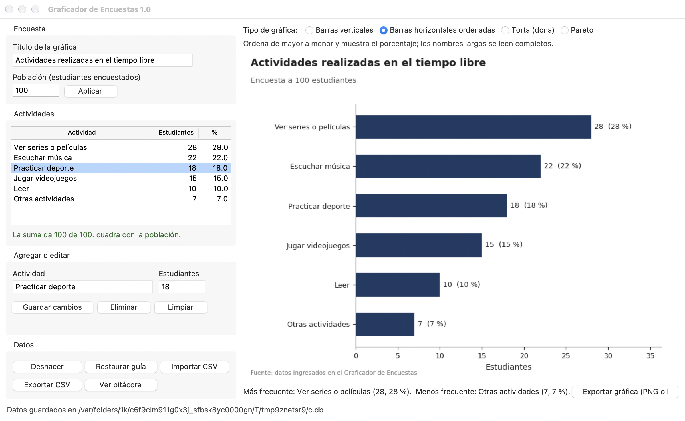
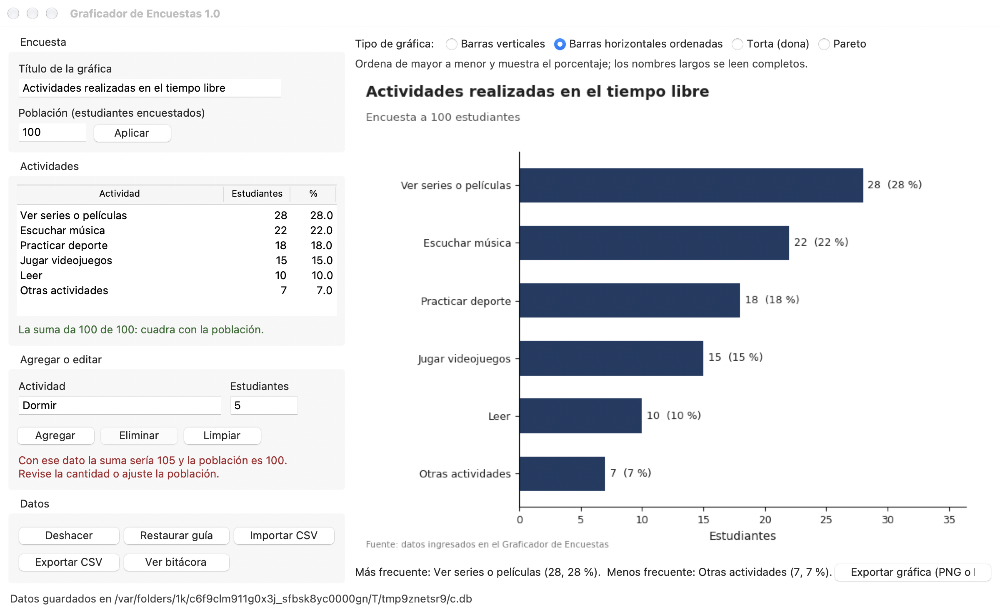
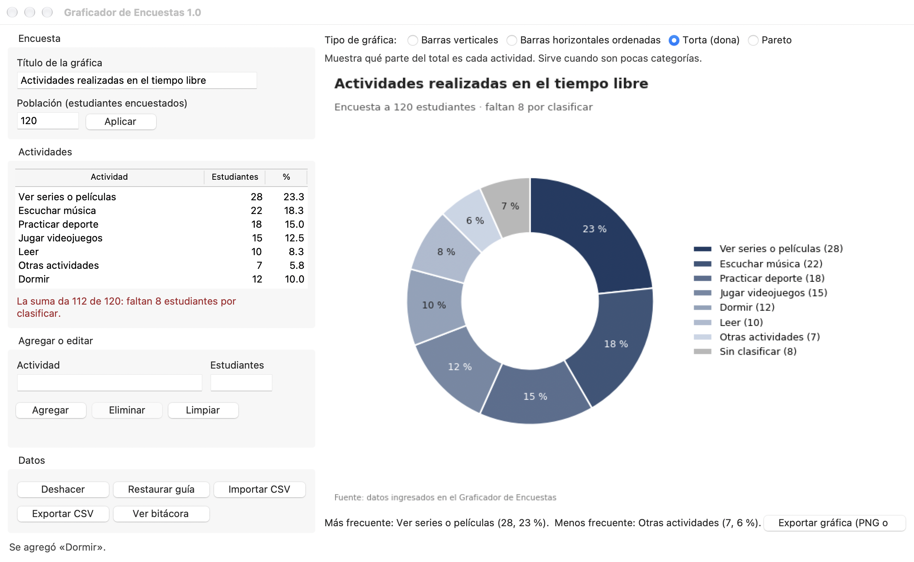
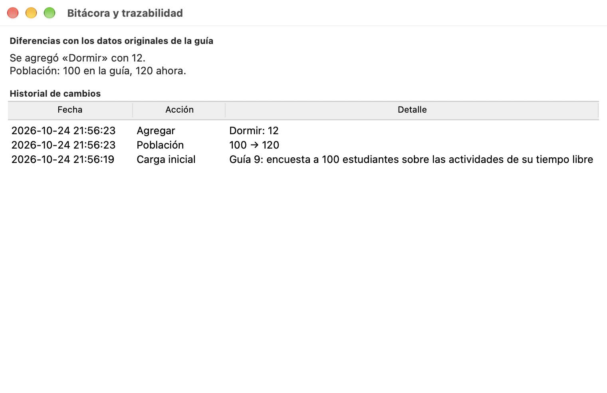

# Fase 2: documentación del Graficador de Encuestas

## Qué hace el programa y con qué datos trabaja

El Graficador de Encuestas es un programa de escritorio para encuestas de opción única, donde cada estudiante cuenta en una sola actividad. Recibe los datos, los valida antes de guardarlos y dibuja la gráfica sola cada vez que uno agrega, edita o borra algo. Arranca cargado con la encuesta de la Fase 1, las seis actividades de tiempo libre de los 100 estudiantes. Lo dejé así porque la guía pide que el software salga de la información entregada y que todo se pueda rastrear hasta esos datos originales. Lo que buscaba es que alguien sin saber programar pase de una tabla de conteos a una gráfica bien hecha, con los porcentajes calculados sobre la población y sin armar nada a mano en Excel.

Lo hice en Python con cuatro piezas que se pueden revisar por separado. Son la ventana en Tkinter, las reglas y el almacenamiento en una base SQLite, las gráficas en matplotlib y una autoprueba que revisa todo en el equipo donde se va a usar. El código completo está en https://github.com/Felipe-Tabares/umb-bi-guia9-graficador. Cada archivo y cada función trae su docstring, que es un comentario al inicio que explica qué hace y por qué está ahí, entonces la documentación del código vive junto al código y no se desactualiza aparte.

## Cómo se ejecuta sin instalar nada

La guía pide que el programa sea portable y sin instalación, y en la sala tampoco se puede instalar software. Por eso lo empaqueté con PyInstaller en modo carpeta, que deja el ejecutable con todo lo que necesita adentro, incluido el propio Python, y basta con descomprimir y darle doble clic a GraficadorEncuestas.exe en Windows o a GraficadorEncuestas.app en macOS. Al principio pensé en el modo de un solo archivo, que se ve más limpio. Lo descarté porque ese modo se descomprime en una carpeta temporal cada vez que abre y se demora más en arrancar. Ademas los antivirus lo marcan con más frecuencia, que es lo último que uno quiere en un computador de la universidad.

Los datos quedan en datos_encuesta.db, al lado del programa. Si se copia la carpeta a otro equipo, los datos se van con ella. Y si la carpeta no deja escribir, como pasa en algunos discos protegidos, el programa no se cae sino que guarda en una carpeta del usuario y lo dice en la barra de abajo. Hay que aclarar que el ejecutable no tiene firma comercial, asi que la primera vez Windows puede mostrar el aviso de que protegió el equipo y toca darle Más información y luego Ejecutar de todas formas.

| Sistema | Archivo | Cómo se abre |
|---|---|---|
| Windows 10 u 11 | GraficadorEncuestas-windows.zip | Descomprimir y abrir GraficadorEncuestas.exe |
| macOS | GraficadorEncuestas-macos.zip | Descomprimir, clic derecho en GraficadorEncuestas.app y Abrir |
| Linux | GraficadorEncuestas-linux.zip | Descomprimir y ejecutar GraficadorEncuestas |

## Requisitos

Los requisitos van con la forma que se usa en una especificación de software: un identificador, lo que debe hacer el sistema y cómo se comprueba. La última columna es la que importa, porque amarra cada requisito a una prueba concreta y así ninguno queda solo como promesa.

| Id | Requisito | Cómo se comprueba |
|---|---|---|
| RF01 | Cargar la encuesta de la guía al abrir por primera vez | Autoprueba: carga los datos y suman 100 |
| RF02 | Agregar, editar y eliminar actividades | Autoprueba: agrega, edita y elimina con la suma al día |
| RF03 | Rechazar nombres vacíos, de más de 40 caracteres o repetidos | Pruebas de validación de nombre |
| RF04 | Aceptar solo cantidades enteras desde 0 | Rechaza negativos, decimales y texto |
| RF05 | Impedir que la suma pase de la población y avisar cuántos faltan | Rechaza pasar de la población |
| RF06 | Dibujar cuatro tipos de gráfica y redibujar al cambiar un dato | Genera las cuatro gráficas |
| RF07 | Exportar la gráfica a PNG o PDF y los datos a CSV | Exporta e importa CSV sin perder datos |
| RF08 | Guardar una bitácora de cambios, deshacer y restaurar los datos de la guía | Bitácora y restauración |
| RNF01 | Ejecutarse sin instalación en Windows, macOS y Linux | Autoprueba del ejecutable en los tres sistemas |
| RNF02 | Mostrar cada error en español claro y sin cerrar la ventana | Prueba de la ventana con un dato inválido |
| RNF03 | Conservar los datos al cerrar y volver a abrir | Prueba de persistencia en disco |

## Arquitectura

La regla que más me importaba era que la validación existiera en un solo sitio. La ventana no revisa nada por su cuenta. Le pasa a la capa de datos lo que escribió el usuario, y la capa de datos devuelve el dato guardado o el motivo del rechazo en una frase que se muestra tal cual en rojo debajo del formulario. Si la misma regla estuviera escrita en la ventana y en la base, tarde o temprano las dos versiones se contradicen. Por ejemplo, que la ventana deje pasar un decimal que la base después rechaza. Ese tipo de error es de los más difíciles de encontrar porque cada parte por separado parece funcionar bien.

Escogí Python porque Tkinter y SQLite vienen incluidos, entonces ventana y base de datos no piden nada adicional. Matplotlib es la librería de gráficas más usada en análisis de datos y exporta a PNG y PDF con la misma función que dibuja en pantalla. Como la guía descarta las aplicaciones web, las PWA y cualquier cosa en HTML, CSS o JavaScript, una interfaz de escritorio nativa era el camino directo y no habia mucho que pensar ahí.

## Modelo de datos

La base tiene cuatro tablas. En categorias está lo que se ve en la tabla del programa. Su columna clave guarda el nombre sin tildes ni mayúsculas con una restricción de valor único, de modo que Escuchar Música y escuchar musica cuentan como la misma actividad aunque se escriban distinto. La tabla datos_originales se llena una sola vez con la encuesta de la guía y no se vuelve a tocar. Sirve para restaurar y para mostrar qué cambió. En bitacora cada cambio queda con la fecha, la acción, el detalle y una copia del estado anterior, y esa copia es la que permite deshacer cualquier cosa, hasta una importación completa de un CSV con muchas filas.

## Diagrama de clases

## Diagrama de flujo del ingreso y la validación

Este es el camino que recorre cada dato antes de guardarse, y con él respondo cómo se garantiza que los datos sean completos, válidos y consistentes. Completo quiere decir que no hay nombre vacío ni cantidad en blanco. Válido, que la cantidad sea un entero desde cero y que el nombre no se repita. Y consistente, que la suma de todas las actividades nunca pase de la población declarada, que es la coherencia entre población e indicadores que pide la comprobación del trabajo, y por eso es la última revisión antes de guardar. El mismo algoritmo quedó en pseudocódigo en el archivo ingreso_validacion.psc, que se abre en PSeInt y genera su propio diagrama.

Cuando la suma queda por debajo de la población el programa no lo bloquea, porque es normal ir ingresando por partes. Lo que hace es avisar en rojo cuántos estudiantes faltan por clasificar, y la torta los muestra como una porción gris aparte. Así el porcentaje de cada actividad se calcula siempre sobre la población real y no sobre lo que se lleva ingresado, porque si lo hiciera al revés una actividad se vería más grande de lo que es en realidad.

## Las gráficas y por qué cada una

| Gráfica | Cuándo sirve |
|---|---|
| Barras verticales | Comparar cantidades entre actividades; es la que trae la guía |
| Barras horizontales ordenadas | Ver el orden de mayor a menor con el porcentaje; los nombres largos se leen completos. Es la propuesta de la Fase 1 |
| Torta (dona) | Ver qué parte del total es cada actividad, solo cuando son pocas categorías |
| Pareto | Ver cuántas actividades concentran la mayor parte de las respuestas |

Las cuatro salen de los mismos datos. Debajo del selector el programa explica para qué sirve la que está escogida. Para presentar yo usaría la de barras horizontales, porque el orden ya cuenta la historia y no hay que ir al eje a buscar valores. La torta la dejé para mostrar las partes de un todo. El Pareto deja ver de una que series y música juntas ya son la mitad de la encuesta, algo que en las barras sueltas toca sumar a mano. Debajo de la gráfica el programa escribe cuál es la actividad más frecuente y cuál la menos con su porcentaje, y si hay empate las nombra todas, porque escoger una sola sería inventarse un ganador, y todo va en un solo azul para no sugerir que una actividad es mejor que otra cuando la encuesta solo mide preferencias.

## Manual de usuario

Al abrir el programa aparece la encuesta de la guía en la tabla de la izquierda y la gráfica a la derecha. Arriba se cambian el título y la población. Los dos se guardan con Aplicar, y para agregar una actividad se escribe el nombre y la cantidad en Agregar o editar y se presiona Agregar o Enter. Para editar basta con hacer clic en una fila de la tabla, con lo que el formulario se llena solo y el botón cambia a Guardar cambios mientras esa fila siga seleccionada.

Si el dato no cumple alguna regla no se guarda nada. El motivo sale en rojo debajo del formulario, y en la Figura 7 se ve el caso en que intenté agregar Dormir con 5 estudiantes cuando la encuesta ya sumaba los 100, donde el programa dice exactamente por qué no lo deja y qué se puede hacer para que entre.

En la Figura 8 subí la población a 120 y agregué Dormir con 12, entonces la suma quedó en 112 y el programa avisa que faltan 8 por clasificar, que la torta muestra como la porción gris.

El botón Ver bitácora abre una ventana con las diferencias frente a los datos originales y con el historial de cambios. Deshacer, o Control Z, devuelve el último cambio. Restaurar guía vuelve a los datos originales sin borrar el historial, entonces siempre queda constancia de lo que se hizo antes. Importar CSV acepta archivos separados por coma o por punto y coma, con o sin encabezado, y si una sola fila viene mal no importa ninguna y dice cuál falló. Exportar gráfica guarda la que esté en pantalla en PNG o en PDF.

## Pruebas y resultados

Probé en tres niveles. Las pruebas unitarias revisan cada regla de validación y el almacenamiento por separado, y son 13. La autoprueba va dentro del mismo programa y se corre con GraficadorEncuestas --autoprueba seguido de una carpeta. Hace 18 pruebas sobre una base temporal sin tocar los datos del usuario, abre la ventana real, usa el formulario con un dato bueno y uno malo, genera las cuatro gráficas y deja un reporte. El tercer nivel responde cómo se comprueba la ejecución en diferentes entornos. Para eso monté una compilación automática en GitHub Actions. Cada vez que subo un cambio, empaqueta el programa en Windows, macOS y Linux y corre la autoprueba sobre el ejecutable ya empaquetado en cada sistema, no sobre el código.

| Dónde corrió | Qué se probó | Resultado |
|---|---|---|
| Windows Server 2025 (GitHub Actions) | Ejecutable empaquetado, con ventana | 18 de 18 |
| macOS (GitHub Actions) | Ejecutable empaquetado, con ventana | 18 de 18 |
| Ubuntu Linux (GitHub Actions) | Ejecutable empaquetado, con pantalla virtual | 18 de 18 |
| Mi Mac con macOS 27 | Código fuente: 13 pruebas unitarias y 18 de autoprueba | 31 de 31 |

En los tres sistemas la prueba de la ventana pasó con el ejecutable ya empaquetado. O sea que el programa abre, recibe el dato bueno, rechaza el malo con su mensaje y cambia entre las cuatro gráficas sin que nadie lo instale. Cada corrida deja su reporte y las gráficas que generó, y los tres archivos .zip quedan publicados en la versión v1.0 del repositorio para descargarlos.

Durante el desarrollo salieron fallas reales. Las dejo anotadas con lo que pasó, porque varias no las habría visto sin las pruebas, sobre todo las del ejecutable.

| Falla encontrada | Corrección |
|---|---|
| El ejecutable empaquetado no abría en macOS ni en Linux: faltaba un módulo interno de numpy, aunque el código fuente pasaba las 18 pruebas | Actualicé PyInstaller y le indiqué que incluyera los submódulos de numpy._core |
| En el Pareto los porcentajes quedaban encima de las barras oscuras y no se leían | Les puse un fondo blanco a las etiquetas |
| En la torta los porcentajes en blanco no se leían sobre las porciones claras | El color del texto se calcula según qué tan oscura es la porción |
| En macOS con modo oscuro los textos grises desaparecían y el botón Ver bitácora quedaba cortado | Fijé la apariencia clara, como se ve en Windows, y pasé los botones a tres columnas |
| Un texto largo debajo de la gráfica empujaba el botón de exportar fuera de la ventana | El botón se ubica primero y el texto ocupa lo que sobra |
| La prueba de la bitácora esperaba 8 registros y había 7 | Estaba mal la prueba, no el programa; ahora compara la secuencia exacta de acciones |

La que más me enseñó fue la primera. Corriendo el código el programa funcionaba perfecto, pero empaquetado se caía apenas abría, y si solo hubiera probado en mi computador lo habría llevado a la sustentación roto. por eso la autoprueba corre sobre el ejecutable ya armado, que es lo que de verdad se va a abrir en la sala, y no solo sobre el código fuente.

## Límites conocidos

El programa asume una encuesta de opción única, donde cada estudiante cuenta una vez, porque así viene la de la guía. En una encuesta de opción múltiple la suma podría pasar de la población con datos que sí son correctos, y ahí la regla de la suma estorbaría en vez de ayudar. El ejecutable no tiene firma digital comercial, entonces Windows y macOS muestran una advertencia la primera vez. Los datos viven en el equipo donde está la carpeta y no en la nube. Eso le sirve a la portabilidad, pero para compartirlos con otra persona toca pasarle la carpeta completa o exportar el CSV desde el programa.
